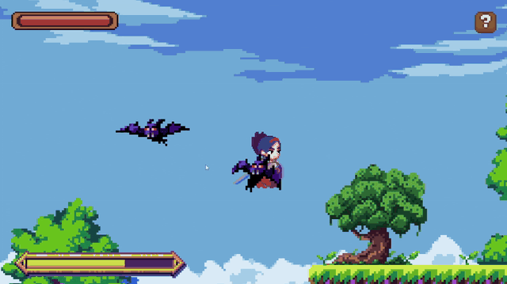
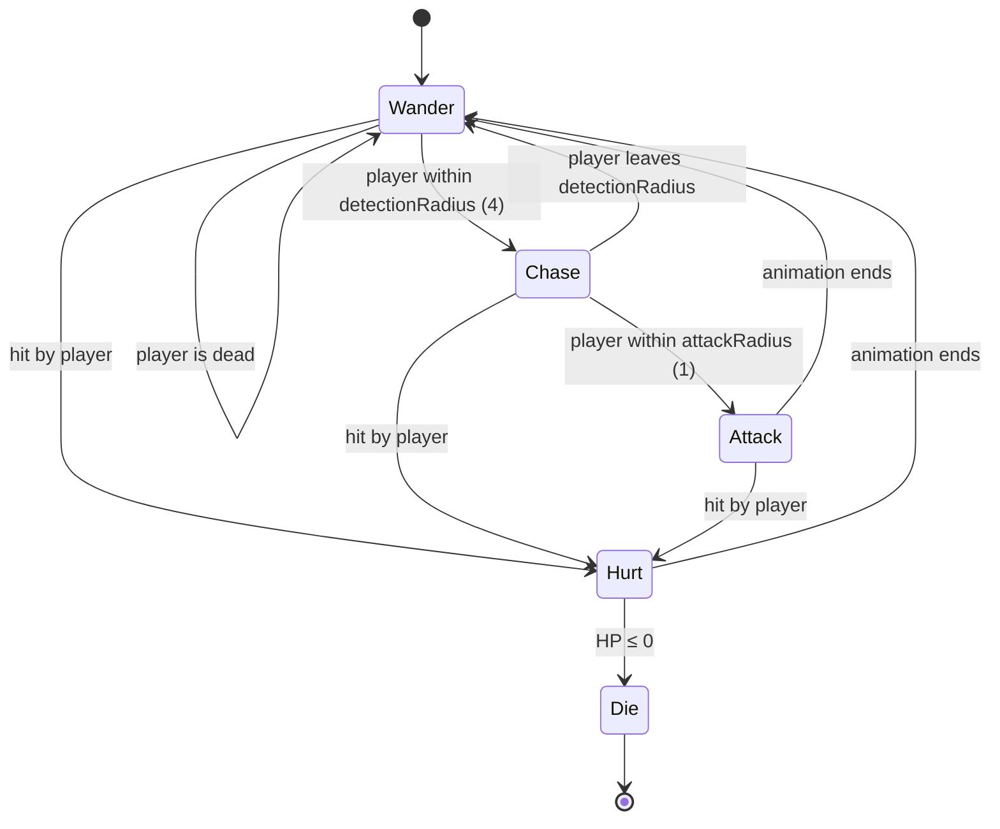
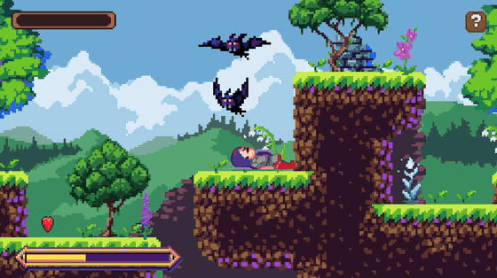
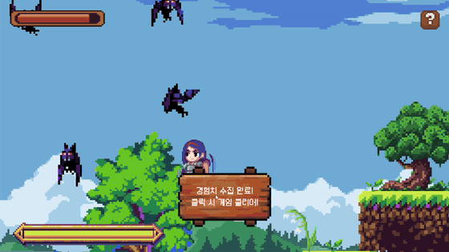

# Pixel Knight

A 2D side-scrolling pixel-art action game made in Unity, built as the midterm project for a Game AI course.
Fight off endless waves of bats, collect hearts to heal, and fill the EXP bar to clear the stage.

<p align="center">
  
</p>

<p align="center">
  <!-- TODO: replace with your itch.io page once the WebGL build is uploaded -->
  <a href="https://YOUR-NAME.itch.io/pixel-knight"><b>▶ Play in your browser (itch.io)</b></a>
</p>

> **Note:** This repository contains the **C# scripts only**, for portfolio purposes.
> Art, audio and font assets are third-party and are not redistributed here (see [Credits](#credits)).

---

## Features

- **4 scenes** — Title → Game → Game Over / Game Clear
- **Player** — move, jump, two attack types (left / right click), hurt / death / victory animations
- **Stats** — HP bar, heart pickups that restore HP, EXP bar that triggers the clear condition
- **Bat enemy AI** — wanders around its spawn point, chases the player when nearby, attacks at close range
- **Bat spawner** — spawns bats just outside the camera view at a fixed interval
- **Drag-to-revive** — on the Game Over screen, drag the fallen knight onto the revive zone to restart
- **Clear scene** — stars fly across the screen on a sine-wave arc

## Controls

| Input | Action |
|---|---|
| `A` / `D` (or `←` / `→`) | Move |
| `Space` | Jump |
| Left click | Attack 1 |
| Right click | Attack 2 |
| `?` button | Show help panel |

## Bat AI

The bat is a simple finite-state machine driven by **distance checks** instead of trigger colliders.



| State | Behaviour |
|---|---|
| **Wander** | Picks a random point within ±2 units of its spawn position, flies there, idles for 1–3 s, then picks a new point. |
| **Chase** | Moves straight toward the player with `Vector2.MoveTowards` and flips its sprite to face them. |
| **Attack** | Randomly plays one of two attack animations. Damage is applied **at the middle frame**, and only if the player is *still* in range — so the player can dodge by moving away mid-swing. |
| **Hurt** | Interrupts any attack; returns to normal behaviour when the animation finishes. |
| **Die** | Gives the player 50 EXP, switches to a dynamic Rigidbody so the body falls with gravity, and is destroyed on landing (or after 2 s). |

When the player dies, every bat ignores them and goes back to wandering.

`BatGenerator` spawns a bat every 3 seconds at a random position inside the camera bounds plus a padding margin, clamped above a minimum Y so bats never spawn underground.

<p align="center">
  
  &nbsp;
  
</p>

## Game Loop

- Player: **50 HP**, bat attack: **5 damage**, heart pickup: **+15 HP**
- Each bat kill: **+50 EXP** — reaching **600 EXP** (12 kills) stops the spawner, plays the victory animation and shows the clear button
- Falling off the map reloads the stage; dying to bats goes to the Game Over scene

## Project Structure

```
Scripts/
├── Player/
│   ├── PlayerController.cs        # movement, jump, attacks, HP, death / victory
│   └── CameraController.cs        # smooth follow camera
├── Enemy/
│   ├── BatController.cs           # bat FSM (wander / chase / attack / hurt / die)
│   └── BatGenerator.cs            # timed spawner around the camera view
├── Items/
│   └── HeartController.cs         # animated healing pickup
├── Directors/
│   ├── GameDirector.cs            # HP / EXP UI, clear condition, BGM switch
│   ├── TitleManager.cs
│   ├── GameOverDirector.cs
│   └── GameClearDirector.cs
└── SceneEffects/
    ├── ReviveController.cs        # drag-and-drop revive on the Game Over screen
    ├── StarController.cs          # sine-arc star movement
    ├── StarGenerator.cs
    ├── SkullController.cs
    ├── BackgroundController.cs    # scrolling title background
    ├── GameBackgroundController.cs
    ├── TitlePlayerController.cs
    ├── GameOverPlayerController.cs
    └── GameClearPlayerController.cs
```

## Tech

- **Engine:** Unity 6 (6000.3.10f1), Universal Render Pipeline (2D)
- **Language:** C#
- Frame-by-frame sprite animation implemented in code (sprite arrays + timer) rather than the Animator
- Physics: `Rigidbody2D`, `Physics2D.OverlapCircleAll` for the player's melee hit detection
- Level built with Tilemap

## Credits

Made by **Sieun Hwang** — game design & programming.

Art, music, sound effects and font are free assets by other creators and are **not included** in this repository.
See [CREDITS.md](CREDITS.md) for the full list.

## License

The source code in this repository is released under the [MIT License](LICENSE).
Third-party assets are **not** covered by this license.
